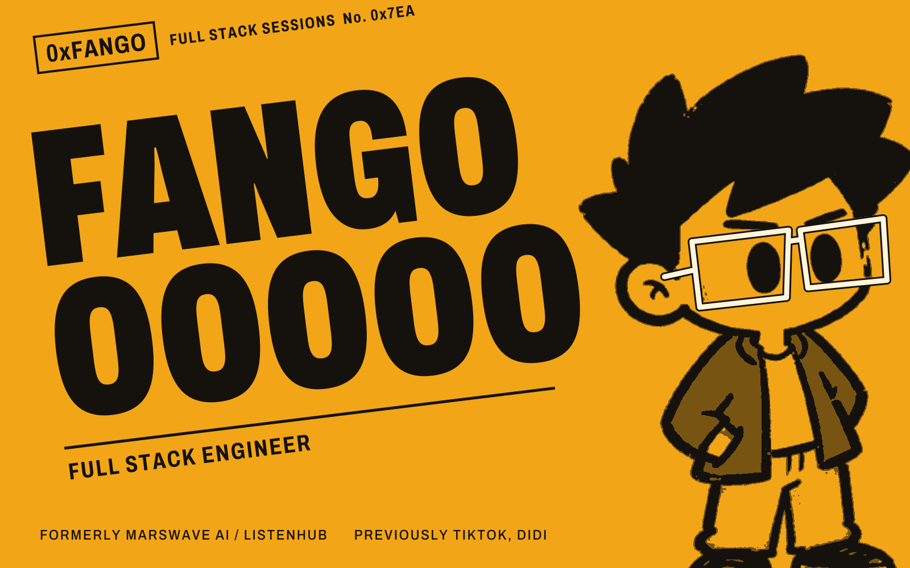

<!-- The poster in assets/ is generated by scripts/build.py; edit the copy there, not the SVG. -->

### Hey, I'm Fangoooooo

Full Stack Engineer, formerly at [MarsWave AI](https://github.com/marswaveai), where I worked on [ListenHub](https://listenhub.ai), turning content into podcasts, speech and video. Previously Sr. Frontend Engineer at TikTok and DiDi.

#### On rotation

  
  &nbsp;&nbsp;
  

Say hi from your terminal: `npx fangge`

`0x` prefix is not a typo. I like hex.

CD spines drawn by <a href="https://spine.stv.pm">Spines</a>.
